# Way Back

Way Back is a dimensional digital watchface for Pebble Time 2 (Emery) and Pebble Round 2 (Gabbro). Its clock uses colored depth on a measured grid.

The face includes Color Slices, Lift, Tunnel, Daylight Blueprint, Graphite, and a custom color look. Custom mode exposes separate day and night background, digit front, digit depth, and grid colors. Day, Night, and Auto modes are selectable. Auto follows the watch's local time; night starts at 7 p.m. and day starts at 7 a.m. by default, with both hours configurable. The date can be Off, YYYY-MM-DD, MM/DD/YYYY, or DD/MM/YYYY in either mode. It follows the watch's 12-hour or 24-hour preference. Live tilt parallax moves the digit depth while the front stays fixed. The setting can be turned off for a static face. A tap also briefly reveals the structure.

An echo-count control offers 1 through 12 receding outlines; three remains the default. Reverse echo direction flips which way the trail recedes for the same wrist tilt, and keeps the previous direction as the default. The foreground digits stay fixed while wrist tilt shifts the echo depth. Twelve time numeral styles include segmented digital treatments, Pebble system faces, Space Grotesk, Cormorant Garamond, Bodoni Moda, and Book Serif. Eight independent decoration settings cover registration corners, short brackets, double brackets, crosshairs, edge ticks, dots, a full frame, and none. The full frame becomes a ring on Round 2. Both settings persist on the watch. The four external font sources are licensed under the SIL Open Font License; source licenses are in `licenses/`. Book Serif uses a subset derivative of Libre Baskerville with a renamed internal font family.

Twelve background patterns are selectable separately from the color look and corner decoration. Blueprint grid remains the default. Each pattern uses the current look's grid color, so it works with day, night, grayscale, and custom palettes. A Solid option leaves the background color plain.

## Native previews


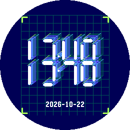

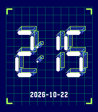


The `media/` folder includes native day and night captures for both watch shapes and custom color examples.

## Store media

The animated previews hold the time and simulated wrist angle at 13:48 while each pair flips the echo direction. Across five pairs they show segmented, wire, digital, serif, and geometric numerals; blue, amber, daylight, grayscale, and green palettes; and five background patterns.

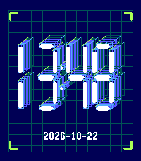
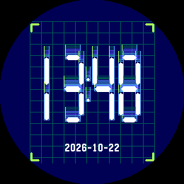

Four native-resolution stills per target are in `media/way-back-emery-store-01-*.png` through `04-*.png` and the matching `gabbro` files. Together with each platform's GIF, they fill five listing image slots. These are candidate listing assets; they have not been uploaded.

Decoration previews from the native Emery emulator:

| Registration | Short brackets | Double brackets | Crosshairs |
|---|---|---|---|
|  | 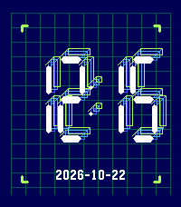 |  |  |
| Edge ticks | Dots | Full frame | None |
| 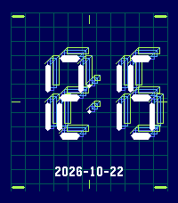 |  |  |  |

Matching Round 2 captures use the `gabbro-decoration-*.png` names. Numeral previews use `emery-font-*.png` and `gabbro-font-*.png`.

Background previews from the native Emery emulator, all at 12:15:

| Blueprint grid | Fine graph | Wide graph | Dot matrix |
|---|---|---|---|
|  | 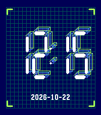 |  |  |
| Crosshair field | Diagonal lines | Diamond mesh | Scanlines |
|  |  | 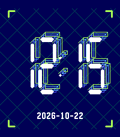 |  |
| Radar rings | Contour frames | Starfield | Solid |
| 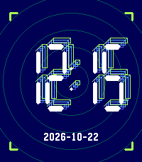 |  | 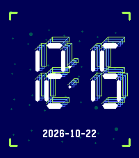 |  |

Matching Round 2 captures use the `gabbro-background-*.png` names. Additional Emery examples show Radar rings in Graphite, Diamond mesh in amber Tunnel, and Dot matrix in Daylight Blueprint.

| Graphite rings | Amber mesh | Daylight dots |
|---|---|---|
| 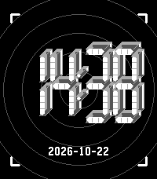 | 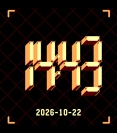 | 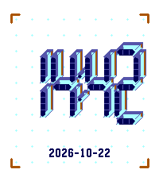 |

The `media/` folder also contains Graphite and custom teal captures from the Emery emulator.

## Current look renders

These native captures use the centered 13:48 layout and the default three echoes. Custom green demonstrates a color combination beyond the built-in looks.

| Look | Pebble Time 2 | Pebble Round 2 |
|---|---|---|
| Color Slices | 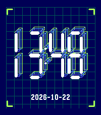 | 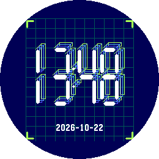 |
| Lift | 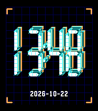 | 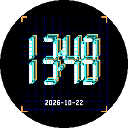 |
| Tunnel | 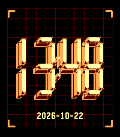 | 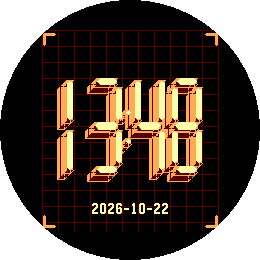 |
| Daylight Blueprint | 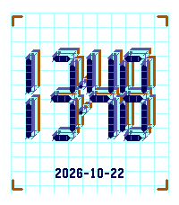 | 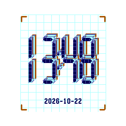 |
| Graphite | 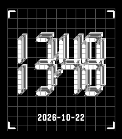 | 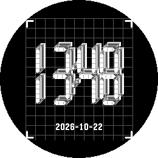 |
| Custom green | 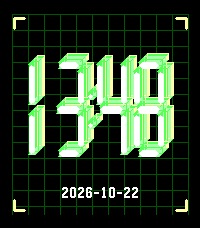 | 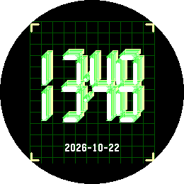 |

Echo depth at the same time and palette:

| 1 echo | 3 echoes | 12 echoes |
|---|---|---|
| 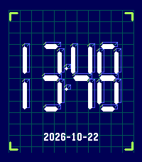 |  | 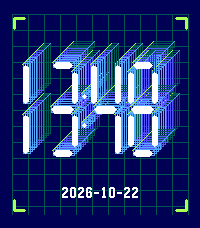 |

The 12-echo trail also works with a classical numeral style: 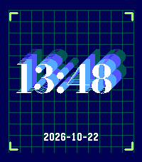. Matching Round 2 echo captures are in `media/gabbro-echo-*-1348.png`.

The default segmented numerals use optical compensation: uncapped vertical strokes reach nearly the full digit height, the narrow `1` sits centrally, and top and bottom bars are shorter. These fixed 13:48 native captures show the change on both targets:

| Pebble Time 2 before | Pebble Time 2 balanced | Pebble Round 2 before | Pebble Round 2 balanced |
|---|---|---|---|
| 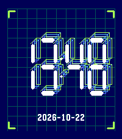 |  | 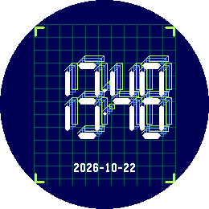 |  |

Tilt examples at a fixed 2:15 are in `media/emery-tilt-left.png`, `media/emery-tilt-right.png`, `media/gabbro-tilt-left.png`, and `media/gabbro-tilt-right.png`. The effect uses the watch accelerometer to infer wrist tilt relative to gravity. It cannot sense the viewer's eye position. Pebble's limited color palette makes the shifting shading three discrete bands.


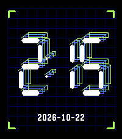

## Build

From `watchface/`:

```sh
npm ci
pebble clean
pebble build
```

Check the bundle from the project root:

```sh
python3 execution/verify_watchface.py
```

The local PBW is `watchface/build/watchface.pbw`. Native captures and emulator backups live under ignored `.tmp/`. See `directives/build_watchface.md` and `knowledge/procedural/build_and_check.md` for fixture and capture steps.

## Release state

Version 0.6.0 is a local dual-platform build. It has not been uploaded to the Pebble/RePebble store and has not been tested on physical watches.
