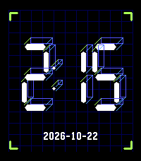

# Gridcore

Gridcore is a dimensional digital watchface for Pebble Time 2 (Emery) and Pebble Round 2 (Gabbro). Its clock uses solid chamfered segments with colored depth on a measured grid.

The face includes Color Slices, Lift, Tunnel, Daylight Blueprint, Graphite, and a custom color look. Custom mode exposes background, digit front, digit depth, and grid colors. The date can be Off, YYYY-MM-DD, MM/DD/YYYY, or DD/MM/YYYY. It follows the watch's 12-hour or 24-hour preference. Optional wrist motion briefly changes the depth projection.

## Native previews




The `media/` folder also contains Graphite and custom teal captures from the Emery emulator.

## Build

From `watchface/`:

```sh
npm ci
pebble clean
pebble build
```

Check the bundle from the project root:

```sh
python3 execution/verify_watchface.py
```

The local PBW is `watchface/build/watchface.pbw`. Native captures and emulator backups live under ignored `.tmp/`. See `directives/build_watchface.md` and `knowledge/procedural/build_and_check.md` for fixture and capture steps.

## Release state

Version 0.1.0 is a local dual-platform build. It has not been uploaded to the Pebble/RePebble store and has not been tested on physical watches.
