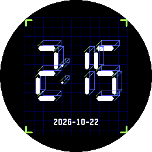
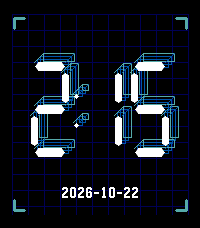
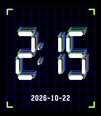

# Gridcore

Gridcore is a dimensional digital watchface for Pebble Time 2 (Emery) and Pebble Round 2 (Gabbro). Its clock uses solid chamfered segments with colored depth on a measured grid.

The face includes Color Slices, Lift, Tunnel, Daylight Blueprint, Graphite, and a custom color look. Custom mode exposes separate day and night background, digit front, digit depth, and grid colors. Day, Night, and Auto modes are selectable. Auto follows the watch's local time; night starts at 7 p.m. and day starts at 7 a.m. by default, with both hours configurable. The date can be Off, YYYY-MM-DD, MM/DD/YYYY, or DD/MM/YYYY in either mode. It follows the watch's 12-hour or 24-hour preference. Live tilt parallax moves the digit depth and shifts its three color bands as the wrist turns; the digit fronts stay fixed. The setting can be turned off for a static face. A tap also briefly reveals the structure.

## Native previews







The `media/` folder includes native day and night captures for both watch shapes and custom color examples.

The `media/` folder also contains Graphite and custom teal captures from the Emery emulator.

Tilt examples at a fixed 2:15 are in `media/emery-tilt-left.png`, `media/emery-tilt-right.png`, `media/gabbro-tilt-left.png`, and `media/gabbro-tilt-right.png`. The effect uses the watch accelerometer to infer wrist tilt relative to gravity. It cannot sense the viewer's eye position. Pebble's limited color palette makes the shifting shading three discrete bands.




## Build

From `watchface/`:

```sh
npm ci
pebble clean
pebble build
```

Check the bundle from the project root:

```sh
python3 execution/verify_watchface.py
```

The local PBW is `watchface/build/watchface.pbw`. Native captures and emulator backups live under ignored `.tmp/`. See `directives/build_watchface.md` and `knowledge/procedural/build_and_check.md` for fixture and capture steps.

## Release state

Version 0.2.0 is a local dual-platform build. It has not been uploaded to the Pebble/RePebble store and has not been tested on physical watches.
